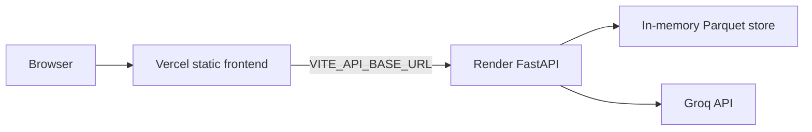

# Deployment Plan

## AI-Powered Restaurant Recommendation System

Host the API on [Render](https://render.com) and the frontend on [Vercel](https://vercel.com). This document is the operator runbook. How the app is built is in [architecture.md](architecture.md). Local setup stays in the [README](../README.md).

New Railway accounts are paused, so this runbook uses Render for the API. The same Dockerfile is what Render builds.

Tick the checklists as you go. Do not put `GROQ_API_KEY` or `backend/.env` in git.

---

## 1. Target



The frontend is a static Vite build. It calls the Render origin directly. There is no Vercel serverless API and no Vite proxy in production.

Deploy in this order. Each step needs the URL from the step before it.

1. Push this repo, including `data/restaurants.parquet`.
2. Deploy the API on Render and copy its public `https://` URL.
3. Deploy the frontend on Vercel with that URL baked in as `VITE_API_BASE_URL`.
4. Set Render `CORS_ORIGINS` to the Vercel origin and wait for Render to redeploy the API.
5. Run the checks in [section 8](#8-verification).

---

## 2. Prerequisites

- This repo on GitHub. Render and Vercel both deploy from that remote.
- A [Render](https://render.com) account and a [Vercel](https://vercel.com) account, each connected to GitHub.
- A Groq API key from [console.groq.com](https://console.groq.com), if you want AI ranking. Leave the key unset to run the fallback ranker. The API still starts.
- Docker, only if you want the local image check in [section 10](#10-check-the-image-locally) before you click deploy.

---

## 3. What the repo already contains

These files are what Render and Vercel build. You do not write them during deploy. Render does not read [railway.toml](../railway.toml). Leave that file alone; it is not part of this setup.

| File | Role |
|------|------|
| [Dockerfile](../Dockerfile) | Python 3.11 image. Installs `backend/requirements.txt`, copies `backend/` and `data/restaurants.parquet`, starts uvicorn on `0.0.0.0` and `$PORT`. |
| [.dockerignore](../.dockerignore) | Keeps `frontend/`, virtualenvs, `.env`, tests, and eval reports out of the image. |
| [frontend/package.json](../frontend/package.json) | `"engines": { "node": ">=20.19.0" }`. Vite 8 will not build on Node 18. |
| [frontend/.nvmrc](../frontend/.nvmrc) | Pins Node 22 so Vercel does not pick Node 18. |
| [frontend/.env.example](../frontend/.env.example) | Documents `VITE_API_BASE_URL`. |
| [data/restaurants.parquet](../data/restaurants.parquet) | Cleaned Bangalore dataset, about 1.1 MB and 9,471 restaurants. Committed so the image does not need Hugging Face at build time. |

`DATA_PATH` stays at its default, `../data/restaurants.parquet`. Settings resolve that path against `backend/`, which matches the layout inside the image (`/app/backend` and `/app/data/restaurants.parquet`). Do not set `DATA_PATH` on Render unless you move the file.

The process does not read `PORT` itself. Render injects `PORT` (default `10000`), and the container command is the only thing that uses it:

```sh
uvicorn app.main:app --host 0.0.0.0 --port ${PORT:-8000}
```

Do not set `PORT` in the Render dashboard. Do not add `ARG` lines for `GROQ_API_KEY` or other secrets in the Dockerfile. Render also passes service environment variables in as Docker build arguments, and a referenced build argument can end up in the image.

---

## 4. Push the dataset

`data/restaurants.parquet` used to be gitignored. It is part of the deploy now. Generate it once if it is not already on disk, from `backend/` with the virtual environment active:

```bash
python -m scripts.ingest
```

Then commit and push the Parquet file together with the Dockerfile. Do not commit `backend/.env`.

- [ ] `data/restaurants.parquet` is tracked by git (`git check-ignore -v data/restaurants.parquet` prints nothing).
- [ ] `backend/.env` is not staged.
- [ ] The branch you will connect to Render and Vercel is pushed.

Do not run ingest on Render. The image already contains the file. A missing file fails the Docker build at `COPY data/restaurants.parquet`, which is earlier and clearer than a running API that returns 503.

---

## 5. Backend on Render

### 5.1 Create the service

1. In the Render dashboard, choose **New** and then **Web Service**.
2. Connect this GitHub repository and select the branch you pushed.
3. Leave **Root Directory** empty. Do not set it to `backend/`. The Dockerfile lives at the repository root and copies both `backend/` and `data/`.
4. Set **Language** to **Docker**. If you leave it on Python, Render will not build this image and the Parquet file will not be in the service.
5. Set **Dockerfile Path** to `Dockerfile`.
6. Leave **Docker Command** empty so Render uses the `CMD` in the Dockerfile.
7. Pick a region and a name. The public host becomes `https://<name>.onrender.com`.
8. Choose the **Free** instance type for a demo. See [section 9](#9-operations) for spin-down.
9. Create the service.

After the service exists, open **Settings** and set the health check. Render's default check only tests that a port is open. This API can open the port and still be unable to serve data: a missing Parquet file returns 503 from `/api/health` while the process stays up.

| Setting | Value |
|---------|--------|
| Language | Docker |
| Root directory | empty (repository root) |
| Dockerfile path | `Dockerfile` |
| Docker command | empty |
| Health check path | `/api/health` |

`GET /api/health` returns 200 only after the Parquet file has loaded. A 503 means the dataset is missing, so a failed health check is the right outcome. Render treats any `4xx` or `5xx` as unhealthy and will not send traffic to that deploy.

### 5.2 Variables

In the Render service **Environment** page, set:

| Variable | Required | Value |
|----------|----------|--------|
| `GROQ_API_KEY` | No | Your Groq key. Omit it, or leave it empty, to use the fallback ranker. |
| `CORS_ORIGINS` | Yes, after Vercel exists | The exact Vercel origin. See [section 7](#7-pair-the-two-origins). You can leave the default in place for the first deploy; `curl` does not send an Origin header. |
| `GROQ_MODEL` | No | Default `openai/gpt-oss-120b`. |
| `LOG_LEVEL` | No | Default `INFO`. |
| `BUDGET_LOW_MAX` | No | Default `300`. Changing it needs a new deploy. Do not rebuild the Parquet file. |
| `BUDGET_MEDIUM_MAX` | No | Default `600`. Must stay greater than `BUDGET_LOW_MAX`. |

Do not set `PORT` or `DATA_PATH`. Do not paste the contents of `backend/.env` into the image.

The other settings (`LLM_TEMPERATURE`, `LLM_REASONING_EFFORT`, `LLM_MAX_COMPLETION_TOKENS`, `LLM_TIMEOUT_SECONDS`, `LLM_DEADLINE_SECONDS`, `MAX_CANDIDATES`) can stay at the defaults in [backend/.env.example](../backend/.env.example). `EVAL_JUDGE_MODEL` is only used by the eval tool. Do not set it on Render.

Saving environment variables starts a new deploy. The new process reads them on startup. A value saved during a running deploy applies to the next one.

### 5.3 Public URL

1. Wait until the deployment is **Live**.
2. Copy the URL at the top of the service page. It looks like `https://<name>.onrender.com`. No path, no trailing slash.

- [ ] The deploy log shows a Docker build, not a native Python install from `backend/` alone.
- [ ] `https://<render-host>/api/health` returns `{"status":"ok","restaurants_loaded":9471}`.

`restaurants_loaded` is the row count in the committed Parquet file. If you regenerate that file, the number changes with it.

On the Free instance, the first request after idle can take about a minute while the service wakes. Wait until the health URL returns JSON before you treat a failure as a bad deploy.

---

## 6. Frontend on Vercel

### 6.1 Import

1. In Vercel, **Add New Project** and import the same GitHub repository.
2. Set **Root Directory** to `frontend`.
3. Framework preset: **Vite**.
4. Install command: `npm install`.
5. Build command: `npm run build`.
6. Output directory: `dist`.
7. Node.js version: **22.x**. [`frontend/.nvmrc`](../frontend/.nvmrc) pins 22. The `engines` field rejects Node 18. Vite 8 needs Node `^20.19.0` or `>=22.12.0`.

No `vercel.json` is required. The app is one page and does not use a client-side router.

### 6.2 Environment variable

Set this **before** the first production build. Vite inlines `VITE_*` variables at build time. Changing the value later does nothing until Vercel builds again.

| Variable | Value |
|----------|--------|
| `VITE_API_BASE_URL` | `https://<render-host>` |

No trailing slash. `https://<render-host>/` becomes `https://<render-host>//api/meta`.

Leave this variable unset on your machine. Local `npm run dev` proxies `/api` to `http://localhost:8000`.

- [ ] Production env has `VITE_API_BASE_URL` set to the Render origin, with no trailing slash.
- [ ] The production deployment finished after that variable was saved.

---

## 7. Pair the two origins

The browser will call Render from the Vercel origin. FastAPI only allows origins listed in `CORS_ORIGINS`. The default is `http://localhost:5173`.

1. Copy the Vercel production origin, for example `https://<project>.vercel.app`. No path, no trailing slash.
2. On Render, set:

```text
CORS_ORIGINS=https://<project>.vercel.app
```

3. Save. Render starts a new deploy. Settings load when the process starts. Wait until that deploy is **Live**.
4. Do not rebuild Vercel for this step. CORS is enforced by the API.

Several origins are comma-separated:

```text
CORS_ORIGINS=https://<project>.vercel.app,http://localhost:5173
```

Keep `http://localhost:5173` in that list only if a local Vite dev server should call the hosted API.

Preview deployments are a different origin, such as `https://<project>-git-<branch>-<team>.vercel.app`. The API does not accept a wildcard. Add each preview origin you care about, or test on the production URL.

- [ ] Render `CORS_ORIGINS` is the exact Vercel origin.
- [ ] The deploy that started after the variable change is Live.

If the Render hostname changes, set the new `VITE_API_BASE_URL` on Vercel and **redeploy the frontend**. Redeploying Render is not enough, because the old hostname is already inside the built JavaScript.

---

## 8. Verification

### API

```bash
curl https://<render-host>/api/health
curl https://<render-host>/api/meta
```

- [ ] `/api/health` is 200 and `restaurants_loaded` is `9471` (or the count from your latest ingest).
- [ ] `/api/meta` is 200 and includes Bangalore localities, including `Banashankari` and `Indiranagar`.

### UI

Open the Vercel URL. The page title is "Where should we eat?". The locality dropdown loads from `/api/meta`. Then run the sample rows from the [README](../README.md#sample-queries). Leave **Results** at 5.

| Row | What you should see |
|-----|---------------------|
| Banashankari, Medium, Italian, rating 4.0 | 5 picks. With `GROQ_API_KEY` set, an AI summary and an explanation on each card. |
| BTM, Low, Mexican, rating 4.5 | A widened-search notice. Every pick is still in BTM. |
| Banaswadi, Low, Mexican, rating 5.0 | No restaurants match, including after relaxation. |
| Indiranagar, Medium, Cafe, rating 4.0, with `GROQ_API_KEY` unset | 5 picks and a "Ranked without AI" notice. |

- [ ] The locality dropdown is populated. It does not say that restaurant data is missing.
- [ ] The Banashankari row returns five cards.
- [ ] The Banaswadi row returns the empty state, not a network error.
- [ ] The browser developer tools show `POST https://<render-host>/api/recommendations`, not a request to the Vercel host `/api/recommendations`.

A same-origin `/api` request means `VITE_API_BASE_URL` was empty or the frontend was built before you set it.

If the Free instance was asleep, the first request can fail or return Render's wake-up page instead of JSON. Call `/api/health` until it returns 200, then submit the form again.

---

## 9. Operations

**Restarts clear memory.** The restaurant table and the one-hour LLM response cache live in the Render process. A restart, a spin-down, or a new deploy reloads the Parquet file and starts with an empty cache. Fallback and empty results are not cached.

**One instance is enough.** Nothing is shared across processes. A second instance would load its own copy of the table and its own cache. The Free plan is a single instance.

**Groq free tier.** The app retries a 429 once when the deadline allows, then returns fallback results. A public demo can hit the daily token cap. The request still succeeds; the UI shows "Ranked without AI".

**Dataset updates.** Run `python -m scripts.ingest` locally, commit the new `data/restaurants.parquet`, and push to the connected branch. Render rebuilds the image. Do not ingest during container start.

**Frontend-only commits.** Render redeploys this service on every push to the connected branch, including commits that only change `frontend/`. That rebuild is harmless. The image does not contain the frontend. Vercel deploys the UI on its own.

**Budget thresholds.** `BUDGET_LOW_MAX` and `BUDGET_MEDIUM_MAX` are applied when the process loads the file. Change the Render variables and wait for the deploy that save starts. Do not regenerate the Parquet file for a threshold change.

**Logs.** Each request writes one JSON line. The log includes a character count for the free-text preference, not the text. The API key is not logged. Read them from the Render service **Logs** tab.

**Sleep.** A Free web service spins down after 15 minutes without a request. The next request wakes it, which takes about a minute. Render can answer that first browser request with an HTML wake-up page that has no CORS headers, so the UI shows a network error until the API is actually up. `/api/health` is the probe that shows it is back. Free instances also have a monthly hour allowance; past that, Render suspends the service until the next month.

---

## 10. Check the image locally

From the repository root, before you rely on Render:

```bash
docker build -t restaurant-api .
docker run --rm -p 8000:8000 -e PORT=8000 -e CORS_ORIGINS=http://localhost:5173 restaurant-api
```

In another terminal:

```bash
curl http://localhost:8000/api/health
```

Expect HTTP 200 and `"status":"ok"`. Stop the container with Ctrl+C.

From `frontend/`:

```bash
npm run build
```

That confirms the Vite production build. It does not call Render.

---

## 11. Troubleshooting

| What you see | Cause | What to do |
|--------------|--------|------------|
| Render build fails on `COPY data/restaurants.parquet` | The file was not pushed, or Root Directory is `backend/`. | Run ingest locally, commit `data/restaurants.parquet`, push. Set Root Directory back to empty. |
| Deploy never becomes healthy, or `/api/health` is 503 | The process started but the store did not load. The body says to run ingest. | Confirm the Parquet file is in the image, Language is Docker, and `DATA_PATH` is unset. |
| Browser console: CORS / blocked origin | `CORS_ORIGINS` is missing that exact origin, or the deploy that saved it is not Live yet. A Free instance waking up can also return an HTML page with no CORS headers. | Set the Vercel origin with no trailing slash and wait for the new deploy. If the service was idle, retry `/api/health` until it returns JSON. |
| Vercel page loads, dropdown says it cannot reach the server, network tab is `/api/...` on the Vercel host | `VITE_API_BASE_URL` was unset at build time. | Set it to the Render origin and redeploy Vercel. |
| Network tab calls `https://<host>//api/meta` | Trailing slash on `VITE_API_BASE_URL` in an old frontend bundle. | Redeploy Vercel. Current builds strip trailing slashes. |
| UI still calls the old Render host | The frontend bundle is stale. | Redeploy Vercel after changing `VITE_API_BASE_URL`. |
| Cards say "Ranked without AI" on every query | `GROQ_API_KEY` is empty, or Groq returned 429 / timed out. | Set the key and wait for the deploy Render starts, or accept fallback. Check Render logs for the Groq status. |
| Render rebuilds when only `frontend/` changes | Auto-deploy follows the connected branch. Render has no watch-path filter in this setup. | Expected. The API image ignores `frontend/`. |
| First click after idle is slow or fails | The Free instance was asleep. | Wait until `/api/health` returns 200, then submit again. |
| Deploy log is a Python buildpack, not Docker | Language was left on Python. | Change Language to Docker, Dockerfile path to `Dockerfile`, clear Docker Command, and redeploy. |

---

## 12. Out of scope

Custom domains, GitHub Actions, a Render Blueprint (`render.yaml`), user accounts, a database, ingest-on-boot, and a CORS wildcard for every `*.vercel.app` preview URL are not part of this setup.
