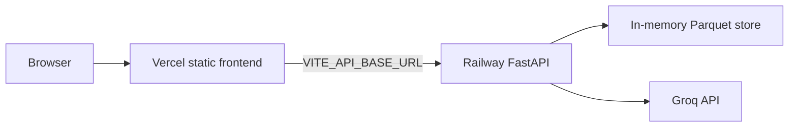

# Deployment Plan

## AI-Powered Restaurant Recommendation System

Host the API on [Railway](https://railway.com) and the frontend on [Vercel](https://vercel.com). This document is the operator runbook. How the app is built is in [architecture.md](architecture.md). Local setup stays in the [README](../README.md).

Tick the checklists as you go. Do not put `GROQ_API_KEY` or `backend/.env` in git.

---

## 1. Target



The frontend is a static Vite build. It calls the Railway origin directly. There is no Vercel serverless API and no Vite proxy in production.

Deploy in this order. Each step needs the URL from the step before it.

1. Push this repo, including `data/restaurants.parquet`.
2. Deploy the API on Railway and copy its public `https://` URL.
3. Deploy the frontend on Vercel with that URL baked in as `VITE_API_BASE_URL`.
4. Set Railway `CORS_ORIGINS` to the Vercel origin and restart the API.
5. Run the checks in [section 8](#8-verification).

---

## 2. Prerequisites

- This repo on GitHub. Railway and Vercel both deploy from that remote.
- A [Railway](https://railway.com) account and a [Vercel](https://vercel.com) account, each connected to GitHub.
- A Groq API key from [console.groq.com](https://console.groq.com), if you want AI ranking. Leave the key unset to run the fallback ranker. The API still starts.
- Docker, only if you want the local image check in [section 10](#10-check-the-image-locally) before you click deploy.

---

## 3. What the repo already contains

These files are what Railway and Vercel build. You do not write them during deploy.

| File | Role |
|------|------|
| [Dockerfile](../Dockerfile) | Python 3.11 image. Installs `backend/requirements.txt`, copies `backend/` and `data/restaurants.parquet`, starts uvicorn on `0.0.0.0` and `$PORT`. |
| [.dockerignore](../.dockerignore) | Keeps `frontend/`, virtualenvs, `.env`, tests, and eval reports out of the image. |
| [railway.toml](../railway.toml) | Dockerfile builder, health check `GET /api/health`, and watch paths so frontend-only commits do not rebuild the API. |
| [frontend/package.json](../frontend/package.json) | `"engines": { "node": ">=20.19.0" }`. Vite 8 will not build on Node 18. |
| [frontend/.nvmrc](../frontend/.nvmrc) | Pins Node 22 so Vercel does not pick Node 18. |
| [frontend/.env.example](../frontend/.env.example) | Documents `VITE_API_BASE_URL`. |
| [data/restaurants.parquet](../data/restaurants.parquet) | Cleaned Bangalore dataset, about 1.1 MB and 9,471 restaurants. Committed so the image does not need Hugging Face at build time. |

`DATA_PATH` stays at its default, `../data/restaurants.parquet`. Settings resolve that path against `backend/`, which matches the layout inside the image (`/app/backend` and `/app/data/restaurants.parquet`). Do not set `DATA_PATH` on Railway unless you move the file.

The process does not read `PORT`. Railway injects `PORT`, and the container command is the only thing that uses it:

```sh
uvicorn app.main:app --host 0.0.0.0 --port ${PORT:-8000}
```

---

## 4. Push the dataset

`data/restaurants.parquet` used to be gitignored. It is part of the deploy now. Generate it once if it is not already on disk, from `backend/` with the virtual environment active:

```bash
python -m scripts.ingest
```

Then commit and push the Parquet file together with the Docker and Railway files. Do not commit `backend/.env`.

- [ ] `data/restaurants.parquet` is tracked by git (`git check-ignore -v data/restaurants.parquet` prints nothing).
- [ ] `backend/.env` is not staged.
- [ ] The branch you will connect to Railway and Vercel is pushed.

Do not run ingest on Railway. The image already contains the file. A missing file fails the Docker build at `COPY data/restaurants.parquet`, which is earlier and clearer than a running API that returns 503.

---

## 5. Backend on Railway

### 5.1 Create the service

1. In Railway, create a project and choose **Deploy from GitHub repo**.
2. Select this repository and the branch you pushed.
3. Leave the service **root directory** at the repository root. Do not set it to `backend/`. The Dockerfile lives at the root and copies both `backend/` and `data/`.

Railway builds with a Dockerfile when it finds one at the root. [railway.toml](../railway.toml) records the same choice plus the health check and watch paths:

```toml
[build]
builder = "DOCKERFILE"
dockerfilePath = "Dockerfile"
watchPatterns = ["backend/**", "data/**", "Dockerfile", "railway.toml"]

[deploy]
healthcheckPath = "/api/health"
healthcheckTimeout = 100
```

Railway's older config-as-code file is not read by every new service (Railway stops reading `railway.toml` on 2026-12-01). After the first deploy, open the service settings and confirm the values below. Set any that are blank.

| Setting | Value |
|---------|--------|
| Builder | Dockerfile |
| Dockerfile path | `Dockerfile` |
| Root directory | `/` (repository root) |
| Healthcheck path | `/api/health` |
| Healthcheck timeout | 100 seconds |
| Watch paths | `backend/**`, `data/**`, `Dockerfile`, `railway.toml` |

`GET /api/health` returns 200 only after the Parquet file has loaded. A 503 means the dataset is missing, so a failed health check is the right outcome.

### 5.2 Variables

In the Railway service variables, set:

| Variable | Required | Value |
|----------|----------|--------|
| `GROQ_API_KEY` | No | Your Groq key. Omit it, or leave it empty, to use the fallback ranker. Mark it as a secret. |
| `CORS_ORIGINS` | Yes, after Vercel exists | The exact Vercel origin. See [section 7](#7-pair-the-two-origins). You can leave the default in place for the first deploy; `curl` does not send an Origin header. |
| `GROQ_MODEL` | No | Default `openai/gpt-oss-120b`. |
| `LOG_LEVEL` | No | Default `INFO`. |
| `BUDGET_LOW_MAX` | No | Default `300`. Changing it needs a restart. Do not rebuild the Parquet file. |
| `BUDGET_MEDIUM_MAX` | No | Default `600`. Must stay greater than `BUDGET_LOW_MAX`. |

Do not set `PORT` or `DATA_PATH`. Do not paste the contents of `backend/.env` into the image.

The other settings (`LLM_TEMPERATURE`, `LLM_REASONING_EFFORT`, `LLM_MAX_COMPLETION_TOKENS`, `LLM_TIMEOUT_SECONDS`, `LLM_DEADLINE_SECONDS`, `MAX_CANDIDATES`) can stay at the defaults in [backend/.env.example](../backend/.env.example). `EVAL_JUDGE_MODEL` is only used by the eval tool. Do not set it on Railway.

### 5.3 Public URL

1. Open the service **Networking** settings and generate a public domain.
2. Copy the URL. It looks like `https://<service>.up.railway.app`. No path, no trailing slash.
3. Wait until the deployment is healthy.

- [ ] The deploy log shows a Docker build, not a Python/Railpack install from `backend/` alone.
- [ ] `https://<railway-host>/api/health` returns `{"status":"ok","restaurants_loaded":9471}`.

`restaurants_loaded` is the row count in the committed Parquet file. If you regenerate that file, the number changes with it.

---

## 6. Frontend on Vercel

### 6.1 Import

1. In Vercel, **Add New Project** and import the same GitHub repository.
2. Set **Root Directory** to `frontend`.
3. Framework preset: **Vite**.
4. Install command: `npm install`.
5. Build command: `npm run build`.
6. Output directory: `dist`.
7. Node.js version: **22.x**. [`frontend/.nvmrc`](../frontend/.nvmrc) pins 22. The `engines` field rejects Node 18. Vite 8 needs Node `^20.19.0` or `>=22.12.0`.

No `vercel.json` is required. The app is one page and does not use a client-side router.

### 6.2 Environment variable

Set this **before** the first production build. Vite inlines `VITE_*` variables at build time. Changing the value later does nothing until Vercel builds again.

| Variable | Value |
|----------|--------|
| `VITE_API_BASE_URL` | `https://<railway-host>` |

No trailing slash. `https://<railway-host>/` becomes `https://<railway-host>//api/meta`.

Leave this variable unset on your machine. Local `npm run dev` proxies `/api` to `http://localhost:8000`.

- [ ] Production env has `VITE_API_BASE_URL` set to the Railway origin, with no trailing slash.
- [ ] The production deployment finished after that variable was saved.

---

## 7. Pair the two origins

The browser will call Railway from the Vercel origin. FastAPI only allows origins listed in `CORS_ORIGINS`. The default is `http://localhost:5173`.

1. Copy the Vercel production origin, for example `https://<project>.vercel.app`. No path, no trailing slash.
2. On Railway, set:

```text
CORS_ORIGINS=https://<project>.vercel.app
```

3. Restart or redeploy the Railway service. Settings load when the process starts. A variable edit does not apply to the already running process.
4. Do not rebuild Vercel for this step. CORS is enforced by the API.

Several origins are comma-separated:

```text
CORS_ORIGINS=https://<project>.vercel.app,http://localhost:5173
```

Keep `http://localhost:5173` in that list only if a local Vite dev server should call the hosted API.

Preview deployments are a different origin, such as `https://<project>-git-<branch>-<team>.vercel.app`. The API does not accept a wildcard. Add each preview origin you care about, or test on the production URL.

- [ ] Railway `CORS_ORIGINS` is the exact Vercel origin.
- [ ] The API process was restarted after the variable change.

If the Railway hostname changes, set the new `VITE_API_BASE_URL` on Vercel and **redeploy the frontend**. Restarting Railway is not enough, because the old hostname is already inside the built JavaScript.

---

## 8. Verification

### API

```bash
curl https://<railway-host>/api/health
curl https://<railway-host>/api/meta
```

- [ ] `/api/health` is 200 and `restaurants_loaded` is `9471` (or the count from your latest ingest).
- [ ] `/api/meta` is 200 and includes Bangalore localities, including `Banashankari` and `Indiranagar`.

### UI

Open the Vercel URL. The page title is "Where should we eat?". The locality dropdown loads from `/api/meta`. Then run the sample rows from the [README](../README.md#sample-queries). Leave **Results** at 5.

| Row | What you should see |
|-----|---------------------|
| Banashankari, Medium, Italian, rating 4.0 | 5 picks. With `GROQ_API_KEY` set, an AI summary and an explanation on each card. |
| BTM, Low, Mexican, rating 4.5 | A widened-search notice. Every pick is still in BTM. |
| Banaswadi, Low, Mexican, rating 5.0 | No restaurants match, including after relaxation. |
| Indiranagar, Medium, Cafe, rating 4.0, with `GROQ_API_KEY` unset | 5 picks and a "Ranked without AI" notice. |

- [ ] The locality dropdown is populated. It does not say that restaurant data is missing.
- [ ] The Banashankari row returns five cards.
- [ ] The Banaswadi row returns the empty state, not a network error.
- [ ] The browser developer tools show `POST https://<railway-host>/api/recommendations`, not a request to the Vercel host `/api/recommendations`.

A same-origin `/api` request means `VITE_API_BASE_URL` was empty or the frontend was built before you set it.

---

## 9. Operations

**Restarts clear memory.** The restaurant table and the one-hour LLM response cache live in the Railway process. A restart or a new deploy reloads the Parquet file and starts with an empty cache. Fallback and empty results are not cached.

**One replica is enough.** Nothing is shared across processes. A second replica would load its own copy of the table and its own cache.

**Groq free tier.** The app retries a 429 once when the deadline allows, then returns fallback results. A public demo can hit the daily token cap. The request still succeeds; the UI shows "Ranked without AI".

**Dataset updates.** Run `python -m scripts.ingest` locally, commit the new `data/restaurants.parquet`, and push. Railway rebuilds because `data/**` is a watch path. Do not ingest during container start.

**Budget thresholds.** `BUDGET_LOW_MAX` and `BUDGET_MEDIUM_MAX` are applied when the process loads the file. Change the Railway variables and restart. Do not regenerate the Parquet file for a threshold change.

**Logs.** Each request writes one JSON line. The log includes a character count for the free-text preference, not the text. The API key is not logged.

**Sleep.** On a free Railway plan the service may sleep when idle. The first request after sleep can take a few seconds. `/api/health` is the probe that shows it is back.

---

## 10. Check the image locally

From the repository root, before you rely on Railway:

```bash
docker build -t restaurant-api .
docker run --rm -p 8000:8000 -e PORT=8000 -e CORS_ORIGINS=http://localhost:5173 restaurant-api
```

In another terminal:

```bash
curl http://localhost:8000/api/health
```

Expect HTTP 200 and `"status":"ok"`. Stop the container with Ctrl+C.

From `frontend/`:

```bash
npm run build
```

That confirms the Vite production build. It does not call Railway.

---

## 11. Troubleshooting

| What you see | Cause | What to do |
|--------------|--------|------------|
| Railway build fails on `COPY data/restaurants.parquet` | The file was not pushed. | Run ingest locally, commit `data/restaurants.parquet`, push. |
| Deploy never becomes healthy, or `/api/health` is 503 | The process started but the store did not load. The body says to run ingest. | Confirm the Parquet file is in the image and `DATA_PATH` is unset. |
| Browser console: CORS / blocked origin | `CORS_ORIGINS` is missing that exact origin, or the API was not restarted. | Set the Vercel origin with no trailing slash, restart Railway. |
| Vercel page loads, dropdown says it cannot reach the server, network tab is `/api/...` on the Vercel host | `VITE_API_BASE_URL` was unset at build time. | Set it to the Railway origin and redeploy Vercel. |
| Network tab calls `https://<host>//api/meta` | Trailing slash on `VITE_API_BASE_URL` in an old frontend bundle. | Redeploy Vercel. Current builds strip trailing slashes. |
| UI still calls the old Railway host | The frontend bundle is stale. | Redeploy Vercel after changing `VITE_API_BASE_URL`. |
| Cards say "Ranked without AI" on every query | `GROQ_API_KEY` is empty, or Groq returned 429 / timed out. | Set the key and restart, or accept fallback. Check Railway logs for the Groq status. |
| Railway rebuilds when only `frontend/` changes | Watch paths are not applied. | Set the watch paths from [section 5.1](#51-create-the-service). |
| First click after idle is slow | The free-tier service was asleep. | Wait for `/api/health` to return 200, then submit again. |

---

## 12. Out of scope

Custom domains, GitHub Actions, user accounts, a database, ingest-on-boot, and a CORS wildcard for every `*.vercel.app` preview URL are not part of this setup.
